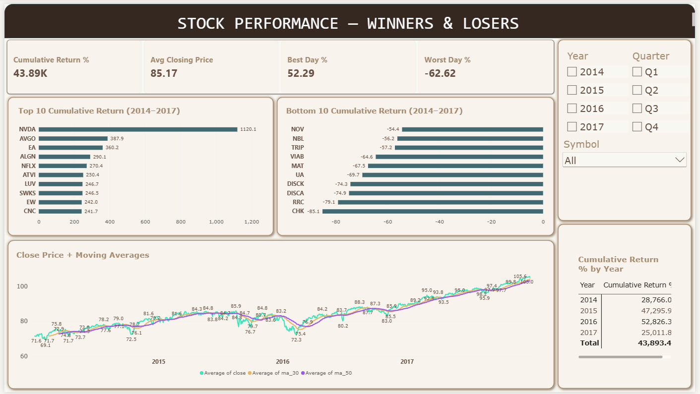

# S&P 500 Stock Market Performance and Trend Analysis (2014–2017)

## End-to-End Data Analytics and Business Intelligence Project

An end-to-end financial data analytics project transforming approximately 497,000 historical stock market records into meaningful insights using Python, MySQL, and Power BI.

The project focuses on historical stock performance, market trends, cumulative returns, volatility, maximum drawdowns, and trading activity across S&P 500 companies between 2014 and 2017.

---

## 1. Project Overview

Financial market datasets contain large volumes of daily trading information. However, raw stock prices alone do not provide sufficient information to understand market performance, identify risk patterns, or compare different stocks effectively.

This project was developed to transform raw historical stock market data into a structured analytical solution.

The complete workflow covers data collection, data cleaning, exploratory data analysis, feature engineering, SQL-based business analysis, and interactive dashboard development.

Python was used for data preparation and statistical analysis, MySQL for querying and extracting business insights, and Power BI for building an interactive three-page analytical report.

### Project Objectives

- Analyze historical S&P 500 stock market performance.
- Identify the highest and lowest performing stocks.
- Calculate daily returns and cumulative performance.
- Understand historical market volatility and price fluctuations.
- Identify stocks experiencing significant drawdowns.
- Analyze the relationship between trading volume and price movements.
- Develop an interactive dashboard for exploring stock market trends.

## 2. Business Problem

The raw dataset contains daily Open, High, Low, Close, and Volume information for multiple stocks.

Although these values describe daily market activity, they do not directly answer important analytical questions.

For example:

- Which stocks performed best over the selected period?
- Which companies experienced the largest declines?
- When was market volatility highest?
- Did unusual trading activity coincide with larger price movements?
- How did individual stocks perform compared with the broader market?

The primary challenge was to transform raw financial records into reliable analytical metrics that could answer these questions.

### Analytical Approach

The project follows a structured workflow:

1. Inspect and understand the raw dataset.
2. Identify missing values, duplicates, and invalid records.
3. Clean and validate the dataset using Python.
4. Perform exploratory data analysis.
5. Engineer additional financial indicators.
6. Import the prepared dataset into MySQL.
7. Execute analytical queries using aggregations, CTEs, and window functions.
8. Build a dimensional data model in Power BI.
9. Develop interactive dashboards and derive historical insights.

## 3. Dataset Information

| Attribute | Details |
|---|---|
| Dataset | S&P 500 Stock Prices |
| Domain | Finance and Stock Market Analytics |
| Time Period | January 2014 – December 2017 |
| Raw Records | 497,472 |
| Original Columns | 7 |
| Final Features | 30+ |
| Main Entity | Stock Symbol |
| Data Frequency | Daily Trading Records |

### Dataset Columns

| Column | Description |
|---|---|
| symbol | Unique stock ticker identifier |
| date | Trading date |
| open | Opening stock price |
| high | Highest stock price during the trading day |
| low | Lowest stock price during the trading day |
| close | Closing stock price |
| volume | Number of shares traded |

### Dataset Source

The project uses the historical S&P 500 Stock Prices dataset covering 2014–2017.

Raw Dataset: [View Raw Dataset](https://github.com/jerry-221/sp500-stock-market-analysis/blob/main/S%26P%20500%20Stock%20Prices%202014-2017.csv)

Cleaned Dataset: [View Cleaned Dataset](https://github.com/jerry-221/sp500-stock-market-analysis/blob/main/S%26P_500_Stock_Prices_clean.csv)

## 4. Tools and Technologies

| Technology | Libraries and Concepts | Purpose |
|---|---|---|
| Python | Python 3.10+ | Data preparation and analysis |
| Pandas | DataFrames, GroupBy, Transform, Rolling | Data cleaning and manipulation |
| NumPy | Conditional logic and numerical operations | Feature engineering |
| Matplotlib | Data visualization | Statistical charts |
| Seaborn | Statistical visualization | Distribution and relationship analysis |
| MySQL | MySQL 8.0 | Database management and analytical queries |
| Power BI | Power Query, DAX, Data Modelling | Interactive business intelligence |
| Jupyter Notebook | Interactive development | Documentation and execution |
| Git and GitHub | Version control | Project management and documentation |

## 5. Data Cleaning and Quality Assurance

The first major stage involved examining the raw dataset and identifying data quality issues.

Instead of immediately performing analysis, the dataset was inspected to understand its structure, missing values, duplicates, and inconsistencies.

### 5.1 Initial Data Inspection

The following checks were performed:

- Dataset dimensions and column information.
- Data types of individual columns.
- Missing value distribution.
- Duplicate records.
- Unique stock symbols.
- Date range validation.
- Statistical summaries.
- Invalid financial values.

### 5.2 Handling Missing Values

**Problem:**

Some records contained missing values in important financial columns, including Open, High, Low, and Close.

**Solution:**

Records containing invalid or missing essential OHLC values were removed rather than replacing historical prices with estimated values.

**Why this approach?**

Stock prices represent actual historical market observations. Replacing missing prices with averages or estimated values could introduce artificial price movements and distort return and volatility calculations.

### 5.3 Duplicate Record Removal

**Problem:**

Duplicate records can affect stock-level aggregations, daily returns, and rolling calculations.

**Solution:**

Duplicate records were identified and removed using the stock symbol and trading date combination.

**Why this approach?**

A stock should have one valid observation for a given trading date in this dataset. Removing duplicate observations prevents double-counting during analysis.

### 5.4 OHLC Validation

**Problem:**

Financial data can contain logically inconsistent price values.

For example, the High price should not be lower than the Low price.

**Solution:**

The following validation conditions were applied:

- High must be greater than or equal to Low.
- High must be greater than or equal to Open.
- High must be greater than or equal to Close.
- Low must be less than or equal to Open.
- Low must be less than or equal to Close.

Invalid records were excluded from the analytical dataset.

**Why this approach?**

These checks help maintain logical consistency in historical price observations and prevent invalid values from affecting financial calculations.

### 5.5 Handling the GOOG and GOOGL Anomaly

**Problem:**

The dataset contained a single isolated GOOG record alongside the GOOGL stock records.

**Solution:**

The isolated GOOG observation was excluded from the analytical dataset.

**Why this approach?**

GOOG and GOOGL are different share classes of Alphabet. The isolated observation did not provide a meaningful time series for analysis and could create inconsistencies in stock-level calculations.

### 5.6 Date and Data Type Validation

Date columns were converted into appropriate datetime formats.

Numerical columns were checked to ensure they could be used correctly in calculations.

**Why this approach?**

Correct data types are essential for chronological sorting, date filtering, time-series calculations, and Power BI date relationships.

### 5.7 Data Quality Report

A separate data quality report was generated to document the cleaning process and provide transparency into the prepared dataset.

Data Quality Report: [View Data Quality Report](https://github.com/jerry-221/sp500-stock-market-analysis/blob/main/data_quality_report.csv)

## 6. Exploratory Data Analysis

After cleaning the dataset, exploratory data analysis was performed to understand the overall structure and distribution of historical stock market activity.

### Key EDA Activities

- Distribution of stock prices.
- Daily trading volume analysis.
- Stock-wise performance comparison.
- Missing value analysis.
- Historical closing price trends.
- Daily return distribution.
- Correlation between numerical variables.
- Identification of unusual observations.

### Visualization Techniques

| Visualization | Analytical Purpose |
|---|---|
| Line Chart | Understand price movements over time |
| Histogram | Examine the distribution of returns |
| Box Plot | Identify outliers and price variation |
| Heatmap | Understand relationships between numerical variables |
| Bar Chart | Compare stock-level performance |
| Scatter Plot | Explore relationships between trading indicators |

**Why EDA was necessary**

EDA helped identify patterns, unusual observations, and relationships before creating advanced financial indicators or performing SQL analysis.

## 7. Feature Engineering

Raw stock market data does not directly provide all the indicators needed for meaningful performance and risk analysis.

Therefore, additional analytical features were created using Pandas and NumPy.

More than 25 additional features were developed during the feature engineering stage.

### 7.1 Daily Returns

**Feature:** `daily_return_pct`

Measures the percentage change in closing price compared with the previous available trading observation.

**Formula:**

Daily Return = ((Current Close - Previous Close) / Previous Close) × 100

**Why it was used:**

Percentage returns make it easier to compare the performance of stocks with different price levels.

### 7.2 Moving Averages

**Features:**

- `ma_7`
- `ma_30`
- `ma_50`

Moving averages calculate the average closing price over a selected rolling window.

**Why they were used:**

They help identify short-term and medium-term price trends while reducing the impact of daily price fluctuations.

### 7.3 Rolling Volatility

**Feature:** `volatility_30d`

Calculated using the rolling standard deviation of daily returns over a 30-observation window.

**Why it was used:**

Volatility helps measure how widely daily returns fluctuate over time and provides an indication of historical price variability.

### 7.4 Maximum Drawdown

**Feature:** `drawdown_pct`

Measures the percentage decline from a stock's previous running peak.

**Why it was used:**

It helps identify the depth of historical price declines and provides an additional perspective on downside risk.

### 7.5 Intraday Price Range

**Feature:** `intraday_range_pct`

Measures the percentage difference between the daily High and Low prices relative to the opening price.

**Why it was used:**

It helps understand the magnitude of price movements within individual trading sessions.

### 7.6 Gap Percentage

**Feature:** `gap_pct`

Measures the percentage difference between the current opening price and the previous available closing price.

**Why it was used:**

It helps identify overnight price differences between consecutive trading sessions.

### 7.7 Relative Volume

**Feature:** `relative_volume`

Compares daily trading volume with its 30-day average volume...

**Why it was used:**

It helps identify periods of unusually high or low trading activity compared with a stock's recent historical volume.

### Important Technical Consideration

During return calculations, Pandas `pct_change()` was used with `fill_method=None`.

This prevents automatic forward-filling of missing observations and avoids generating artificial returns from values that were not actually observed.

Rolling calculations were grouped by stock symbol before being applied.

This ensures that one company's historical values do not affect another company's moving averages or volatility calculations.

## 8. SQL Analysis Using MySQL

After data cleaning and feature engineering, the prepared dataset was imported into MySQL for structured analytical querying.

More than 20 SQL queries were developed to answer the project's business questions.

### SQL Concepts Applied

| SQL Concept | Application |
|---|---|
| SELECT | Retrieve relevant stock information |
| WHERE | Filter stocks and trading periods |
| GROUP BY | Analyze stock-wise and time-based performance |
| ORDER BY | Sort analytical results |
| Aggregate Functions | Calculate averages, totals, minimums, and maximums |
| CASE | Classify positive and negative trading days |
| Subqueries | Perform nested analytical calculations |
| CTEs | Organize complex analytical queries |
| Window Functions | Perform chronological stock analysis |
| ROW_NUMBER() | Identify first and last trading observations |
| DENSE_RANK() | Rank stock performance |
| NTILE() | Divide observations into volume groups |
| LAG() | Access previous trading observations |

### Key SQL Business Analysis

1. Identify the highest-performing stocks based on cumulative returns.
2. Identify the lowest-performing stocks.
3. Calculate yearly and monthly average returns.
4. Analyze positive and negative trading days.
5. Compare stock volatility.
6. Identify maximum historical drawdowns.
7. Analyze trading volume distribution.
8. Compare high-volume and low-volume trading sessions.
9. Rank stock performance using window functions.
10. Identify first and last available closing prices.

### Important SQL Challenge: Cumulative Return

**Problem:**

Using `MIN(close)` and `MAX(close)` to calculate cumulative returns would produce incorrect results because these functions identify the lowest and highest prices, not the chronological starting and ending prices.

**Solution:**

CTEs and `ROW_NUMBER()` were used with chronological ordering to identify the first and last available observations for each stock.

**Why this approach?**

Chronological identification ensures that cumulative performance is calculated using the actual starting and ending prices rather than historical price extremes.

SQL Analysis File: [Explore SQL Queries](https://github.com/jerry-221/sp500-stock-market-analysis/blob/main/sp500_analysis_queries.sql)

## 9. Power BI Dashboard Development

Power BI was used to transform the prepared analytical data into an interactive three-page report.

The report was developed using a dimensional data model, DAX measures, interactive slicers, and multiple visualization types.

### 9.1 Data Modelling

A Star Schema approach was implemented.

The model consists of:

**Fact Table**

`FactStockPrices`

Contains stock-level historical observations and analytical numerical values.

**Dimension Tables**

`DimDate`

Contains date-related attributes such as Year, Quarter, Month, and Date.

`DimStock`

Contains stock identification attributes such as Symbol.

**Why Star Schema?**

A Star Schema separates numerical transaction data from descriptive dimensions.

This makes filtering, aggregation, and report development easier to manage and provides a structured foundation for analytical reporting.

### 9.2 DAX Measures

DAX measures were developed to calculate important financial indicators dynamically.

These measures support:

- Average Closing Price
- Total Trading Volume
- Average Daily Return
- Positive Trading Days
- Negative Trading Days
- Cumulative Returns
- Stock Performance Rankings
- Volatility Analysis
- Drawdown Analysis

Measures were designed to respond to report filters and slicer selections.

### 9.3 Dashboard Pages

#### Page 1: Market Overview

**Objective:** Understand the overall historical market performance.

Key elements:

- Market performance overview.
- Average closing price.
- Total trading volume.
- Positive and negative trading days.
- Historical price trends.
- Year and quarter filters.

**Business Value:**

Provides a high-level understanding of market activity and historical performance across the selected period.

**Screenshot:**


#### Page 2: Stock Performance

**Objective:** Compare individual stock performance and identify historical winners and losers.

Key elements:

- Top-performing stocks.
- Lowest-performing stocks.
- Cumulative return comparison.
- Stock price trends.
- Moving average analysis.
- Stock-level filtering.
- Drill-down analysis.

**Business Value:**

Helps identify individual stocks that significantly outperformed or underperformed during the selected historical period.

**Screenshot:**



#### Page 3: Volatility and Trading Activity

**Objective:** Analyze historical risk indicators and trading behaviour.

Key elements:

- Stock volatility comparison.
- Maximum drawdown analysis.
- Trading volume analysis.
- Relative volume.
- Intraday price range.
- Volatility versus daily return scatter plot.
- Stock-level drillthrough.

**Business Value:**

Provides a more detailed understanding of historical price variability, downside movements, and trading activity.

**Screenshot:**


### Interactive Features

- Year and Quarter slicers.
- Stock Symbol filtering.
- Cross-filtering between visuals.
- Stock-level drillthrough.
- Dynamic DAX calculations.
- Interactive performance comparisons.

### Power BI Project File

[Download Interactive Power BI Report](SP500_Dashboard.pbix)

## 10. Key Historical Insights

The analysis identified several notable patterns across the 2014–2017 dataset.

### 10.1 High-Performing Stocks

NVIDIA (NVDA) emerged as a significant historical outlier, with approximately 1,120% cumulative price appreciation based on the project's calculations.

Netflix (NFLX) also demonstrated substantial historical growth, with approximately 270% cumulative appreciation.

This highlights the difference between individual stock performance and broader market averages.

### 10.2 Underperforming Stocks

Several stocks experienced substantial declines during the selected period.

Companies such as Chesapeake Energy (CHK) and Range Resources (RRC) appeared among the weaker historical performers, reflecting the pressure experienced by parts of the energy sector during the oil price downturn.

### 10.3 Historical Volatility Patterns

The analysis indicated higher volatility during parts of 2015 and 2016 compared with 2017.

This demonstrates how historical market conditions can influence stock price variability.

### 10.4 Trading Volume and Price Movements

The analysis explored whether trading sessions with unusually high relative volume were associated with wider intraday price ranges.

The results suggested a relationship between elevated trading activity and larger intraday movements in the analyzed observations.

However, correlation does not establish causation, and high trading volume alone cannot confirm institutional activity or explain the reason behind a price movement.

## 11. Challenges Faced and Solutions Implemented

| Challenge | Solution | Reason |
|---|---|---|
| Missing OHLC values | Removed invalid observations | Avoid artificial financial values |
| Duplicate records | Validated symbol and date combinations | Prevent double-counting |
| Incorrect OHLC relationships | Applied logical validation rules | Maintain price consistency |
| Isolated GOOG observation | Excluded the isolated record | Avoid misleading time-series analysis |
| Incorrect return calculations | Used `pct_change(fill_method=None)` | Prevent automatic filling |
| Rolling calculations across stocks | Used GroupBy before rolling calculations | Maintain stock-level separation |
| Incorrect cumulative return calculation | Used CTEs and chronological window functions | Identify actual first and last prices |
| Complex Power BI relationships | Implemented Star Schema | Improve model organization |
| Dynamic dashboard calculations | Developed DAX measures | Support interactive filtering |

## 12. Repository Structure

```text
sp500-stock-market-analysis/
│
├── README.md
│
├── S&P 500 Stock Prices 2014-2017.csv
├── S&P_500_Stock_Prices_clean.csv
├── data_quality_report.csv
│
├── S&P_500_Stock_Prices .ipynb
│
├── sp500_analysis_queries.sql
├── SP500_Dashboard.pbix
│
└── Dashboard_Screenshots/
    ├── page1_market_overview.png
    ├── page2_stock_performance.png
    └── page3_volatility_activity.png
```

## 13. How to Run This Project

### Prerequisites

- Python 3.10 or later
- Jupyter Notebook or JupyterLab
- MySQL 8.0
- MySQL Workbench
- Power BI Desktop
- Git

### Step 1: Clone the Repository

```bash
git clone https://github.com/jerry-221/sp500-stock-market-analysis.git

cd sp500-stock-market-analysis
```

### Step 2: Install Required Python Libraries

```bash
pip install pandas numpy matplotlib seaborn sqlalchemy pymysql jupyter
```

### Step 3: Run Python Analysis

1. Open the Jupyter Notebook.
2. Execute the notebook cells in order.
3. Inspect the raw dataset.
4. Perform data cleaning and validation.
5. Execute exploratory data analysis.
6. Perform feature engineering.
7. Generate the cleaned dataset.
8. Generate the data quality report.

### Step 4: Perform SQL Analysis

1. Open MySQL Workbench.
2. Create a database named `sp500_analysis`.
3. Import the cleaned CSV into MySQL.
4. Execute the SQL queries.
5. Review the analytical outputs.

### Step 5: Open the Power BI Report

1. Open Power BI Desktop.
2. Load `SP500_Dashboard.pbix`.
3. Verify the data source paths.
4. Refresh the dataset if necessary.
5. Explore the three report pages.
6. Interact with slicers, charts, and drillthrough functionality.

## 14. Conclusion

This project demonstrates a complete end-to-end data analytics workflow using real-world historical financial data.

Starting with approximately 497,000 raw stock market records, the project progressed through data inspection, cleaning, validation, exploratory data analysis, feature engineering, SQL-based analysis, and interactive Power BI reporting.

The most valuable part of this project was not simply creating visualizations, but understanding the problems within the data and selecting appropriate analytical methods to solve them.

Python helped transform raw financial records into meaningful analytical features. MySQL enabled structured investigation through advanced SQL techniques. Power BI brought the findings together into an interactive reporting solution.

Overall, the project strengthened practical skills in data preparation, analytical thinking, SQL querying, financial metrics, data modelling, and business intelligence.

## 15. Future Improvements

Although the project covers a complete historical analytical workflow, several improvements could make it more comprehensive.

### Adjusted Closing Prices

Incorporate adjusted closing prices to account for stock splits and dividends when calculating historical shareholder returns.

### Sector-Level Analysis

Integrate company-sector information to compare performance across Technology, Healthcare, Energy, Financials, and other industries.

### Benchmark Comparison

Compare individual stock performance against an appropriate market benchmark to understand relative performance.

### Advanced Risk Analysis

Introduce additional financial indicators such as Sharpe Ratio, Beta, and rolling correlation.

### Predictive Analytics

Explore time-series forecasting and machine learning techniques for studying historical price and volatility patterns.

### Automated Data Pipeline

Develop an automated workflow to collect, validate, process, and refresh financial datasets.

## 16. Skills Demonstrated

**Programming and Data Analysis**

Python, Pandas, NumPy, Matplotlib, Seaborn, Exploratory Data Analysis, Data Cleaning, Feature Engineering.

**Database and SQL**

MySQL, Joins, Aggregations, Subqueries, CTEs, Window Functions, Ranking, Analytical Queries.

**Business Intelligence**

Power BI, Power Query, DAX, Star Schema, Data Modelling, Interactive Reporting, Drillthrough.

**Analytical Skills**

Data Quality Assurance, Financial Data Analysis, Trend Analysis, Performance Comparison, Volatility Analysis, Problem Solving, Business Insights.

## 17. Author

**Pranav Patil**

Aspiring Data Analyst

Skills: Python | MySQL | Power BI | Excel | Data Analytics

GitHub: [Explore My GitHub Projects](https://github.com/jerry-221)

---

This project was developed as part of my practical learning journey in Data Analytics, with a focus on applying technical skills to real-world datasets and business problems.
