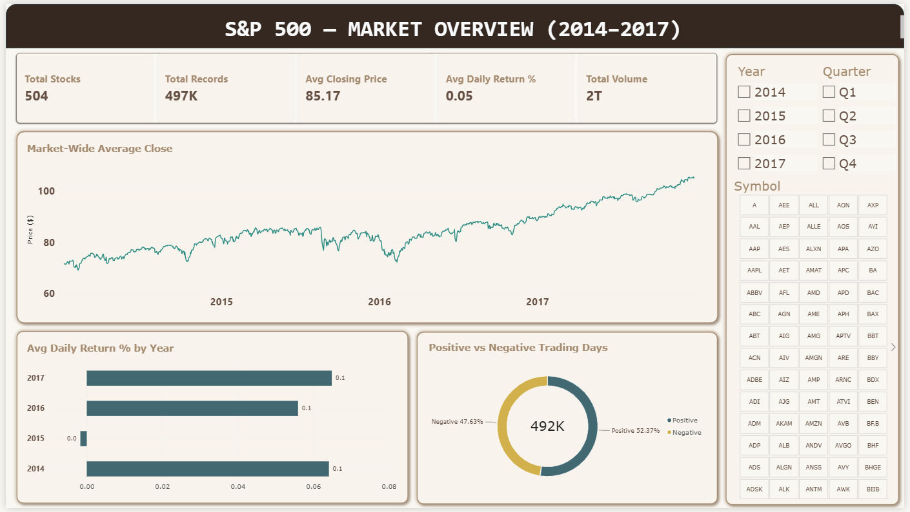
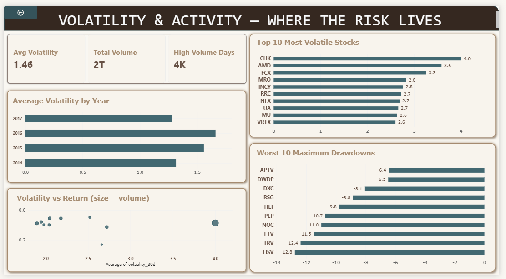

# S&P 500 Stock Market Performance & Trend Analysis (2014–2017)

<p align="center">
  <strong>An End-to-End Data Analytics & Business Intelligence Project</strong>
  <br/>
  Turning 500,000+ raw stock market records into actionable investment and risk insights using Python, MySQL, and Power BI.
</p>

<p align="center">
  
  
  
  
</p>

---

## 1. Project Overview

This is an end-to-end data analytics and business intelligence solution analyzing historical daily stock data for S&P 500 companies from January 2014 to December 2017. 

The project transforms nearly 500,000 raw records into structured insights regarding market trends, individual stock performance, volatility, and trading activity. 

By utilizing Python for data engineering, MySQL for advanced window-function analysis, and Power BI for interactive visualization, the project identifies the macroeconomic shifts and individual outliers that defined the market during this four-year window.

**The objective:** Transform raw market data into meaningful insights that support risk assessment, trend identification, and historical performance comparison.

## 2. Business Problem & Objectives

### The Business Problem

Raw stock data (Open, High, Low, Close, Volume) contains daily noise but lacks the engineered metrics required to measure risk, momentum, and true performance. Without normalizing this data, it is impossible to fairly compare a $10 stock against a $1,000 stock, or identify which assets are generating sustainable returns versus those experiencing high volatility.

### Key Business Questions

1. Which stocks generated the highest cumulative returns between 2014 and 2017?
2. Which stocks experienced the most severe price declines and maximum drawdowns?
3. Which years and months recorded the highest average daily returns and volatility?
4. Are high-volume trading days associated with larger intraday price movements?
5. Which stocks consistently traded above their 30-day moving averages?
6. How do top-performing stocks (e.g., NVDA, NFLX) compare against market averages over time?

## 3. Dataset Information

| Attribute | Details |
|---|---|
| Dataset | S&P 500 Stock Prices (2014-2017) |
| Source | Historical Financial Market Data |
| Records | 497,472 raw rows |
| Columns | 7 base columns (expanded to 30+ via feature engineering) |
| Time Period | Jan 2014 – Dec 2017 |
| Domain | Finance / Stock Market Analytics |

### Important Dataset Attributes

- `symbol` – Stock ticker identifier (e.g., AAPL, NVDA).
- `date` – Trading date.
- `open`, `high`, `low`, `close` – Daily price action.
- `volume` – Number of shares traded.
- `daily_return_pct` – Engineered percentage change in closing price.
- `ma_30` – Engineered 30-day moving average.
- `volatility_30d` – Engineered rolling standard deviation of returns.
- `drawdown_pct` – Engineered maximum drawdown from peak.

**Dataset Files:**
- [View Raw Dataset](https://github.com/jerry-221/sp500-stock-market-analysis/blob/main/S%26P%20500%20Stock%20Prices%202014-2017.csv)
- [View Cleaned Dataset](https://github.com/jerry-221/sp500-stock-market-analysis/blob/main/S%26P_500_Stock_Prices_clean.csv)

## 4. Tools & Technologies

| Technology | Libraries / Concepts | Purpose |
|---|---|---|
| Python | Python 3.10+ | Data preparation and analysis |
| Pandas | DataFrames, Transform, GroupBy | Data cleaning, rolling windows, shifting |
| NumPy | `np.select`, Mathematical logic | Conditional classification and metrics |
| Matplotlib | Visualization | Exploratory data visualization |
| Seaborn | Statistical visualization | Distribution and trend analysis |
| MySQL | MySQL 8.0 | Database management and SQL analysis |
| Power BI | DAX, Star Schema, Interactive Visuals | Dashboard development and BI |

## 5. Methodology: Problems, Solutions & Rationale

During the data preparation and analysis phases, several critical data anomalies and architectural challenges were identified and resolved.

### Challenge 1: Missing and Illogical OHLC Data
**The Problem:** The raw dataset contained missing values and logical errors, such as a `high` price being lower than the `low` price.
**The Solution:** Instead of imputing prices with averages (which creates artificial zero-volatility days), these invalid rows were dropped. The data was strictly validated to ensure `low <= open, close <= high`. 
**The Rationale:** In financial modeling, data integrity is paramount. Imputing stock prices distorts historical reality and severely skews technical indicators like moving averages.

### Challenge 2: The `GOOG` / `GOOGL` Data Anomaly
**The Problem:** The dataset contained a single stray row for `GOOG` (which represents the same company as `GOOGL`), which would pollute time-series aggregations.
**The Solution:** The single `GOOG` row was dropped to maintain a clean, 1-to-1 relationship per trading day per unique ticker.

### Challenge 3: Silent Forward-Filling in Returns
**The Problem:** Pandas `pct_change()` defaults to forward-filling missing data, which can create fake returns on days where data should simply be blank.
**The Solution:** Used `.pct_change(fill_method=None)` to strictly calculate returns only when the previous valid trading day exists, preventing artificial data leakage.

### Challenge 4: Calculating Cumulative Returns in SQL
**The Problem:** Calculating the cumulative return of a stock requires finding the first and last available trading price. A simple `MIN(close)` and `MAX(close)` is incorrect because it finds the all-time high/low, not the start/end price.
**The Solution:** Utilized SQL Window Functions (`ROW_NUMBER() OVER (PARTITION BY symbol ORDER BY date)`) inside Common Table Expressions (CTEs) to accurately isolate the chronological first and last day for every ticker.

## 6. Python Analysis – Data Cleaning & EDA

Python was used to perform data cleaning, quality assurance, and feature engineering. A total of 25+ new columns were created to normalize the data.

Key engineered features include:
- **Return Metrics:** `daily_return_pct`, `intraday_range_pct`, `gap_pct`.
- **Trend Indicators:** 7, 30, and 50-day Moving Averages (`ma_7`, `ma_30`, `ma_50`).
- **Risk Indicators:** 30-day rolling volatility and cumulative drawdown.
- **Activity Indicators:** Relative volume (daily volume divided by 30-day average volume).

**Python Notebook:**
- [Explore Python Data Cleaning & EDA Notebook](https://github.com/jerry-221/sp500-stock-market-analysis/blob/main/S%26P_500_Stock_Prices%20.ipynb)
- [View Data Quality Report](https://github.com/jerry-221/sp500-stock-market-analysis/blob/main/data_quality_report.csv)

## 7. SQL Analysis – MySQL

After cleaning, the dataset was imported into MySQL. Over 20 analytical queries were developed, ranging from basic aggregations to advanced window functions.

### SQL Concepts Applied

| SQL Concept | Application |
|---|---|
| SELECT & WHERE | Filtering by year, stock, or volume thresholds |
| GROUP BY | Yearly and monthly market performance |
| Aggregate Functions | Average returns, standard deviation (volatility) |
| CTEs (WITH) | Structuring complex multi-step analyses |
| Window Functions | `ROW_NUMBER()` for first/last price extraction |
| NTILE() | Dividing trading days into volume quintiles |
| DENSE_RANK() | Ranking stock performance year-by-year |
| Conditional Aggregation | Isolating positive vs. negative trading days |

**SQL File:**
- [Explore SQL Business Analysis Queries](https://github.com/jerry-221/sp500-stock-market-analysis/blob/main/sp500_analysis_queries.sql)

## 8. Power BI Dashboard

Developed a three-page interactive Power BI dashboard utilizing a Star Schema (`FactStockPrices`, `DimDate`, `DimStock`) to optimize performance and filtering.

### Dashboard Preview

#### Page 1 – Market Overview
Focuses on macro-level market trends over the four years, highlighting average closing prices and the ratio of positive to negative trading days.


#### Page 2 – Stock Performance (Winners & Losers)
Identifies the top and bottom cumulative performers. Includes a drill-down chart to view an individual stock's price against its moving averages.


#### Page 3 – Volatility & Activity
Analyzes risk. It highlights the most volatile stocks, maximum drawdowns, and plots the relationship between unusual trading volume and intraday price ranges.


### Power BI Project File
- [Download Interactive Power BI Dashboard (.pbix)](https://github.com/jerry-221/sp500-stock-market-analysis/blob/main/SP500_Dashboard.pbix)

## 9. Key Insights & Findings

The analysis revealed several significant patterns across the 2014-2017 market.

**1. Extreme Outliers Drive Market Returns**
While the market average steadily climbed, the top 10 cumulative returns were dominated by massive outliers. NVIDIA (`NVDA`) led the pack with an astonishing 1120% return, followed by Netflix (`NFLX`) at 270%. 

**2. The Energy Sector Collapse**
The bottom 10 performers during this period were heavily concentrated in the energy sector. The 2014–2016 oil price crash dragged companies like Chesapeake Energy (`CHK`) and Range Resources (`RRC`) down by approximately 79% to 85%. 

**3. Volatility Clustering**
Market volatility was noticeably higher in 2015 and 2016 (driven by the August 2015 flash crash and early 2016 global market panic) compared to the historically calm baseline of 2017, which showed the lowest average volatility.

**4. Volume as a Price Signal**
As visualized on Page 3, trading days with unusually high relative volume (3x the 30-day average or more) correlated with significantly wider intraday price ranges. This confirms that sudden volume spikes are reliable indicators of institutional activity or major news events.

## 10. Repository Structure

```text
sp500-stock-market-analysis/
│
├── README.md
│
├── S&P 500 Stock Prices 2014-2017.csv
├── S&P_500_Stock_Prices_clean.csv
├── data_quality_report.csv
│
├── S&P_500_Stock_Prices .ipynb
├── sp500_analysis_queries.sql
│
├── SP500_Dashboard.pbix
│
└── Dashboard_Screenshots/
    ├── page1_market_overview.png
    ├── page2_stock_performance.png
    └── page3_volatility_activity.png
